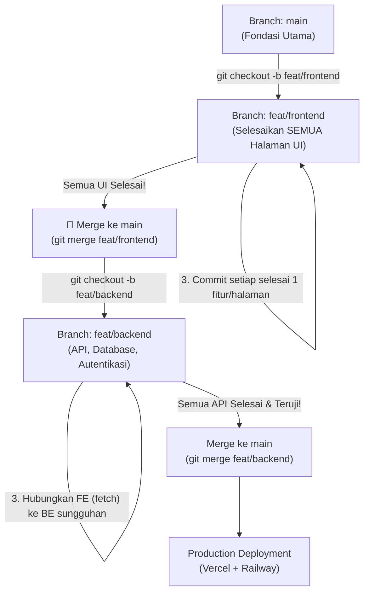

#  Panduan Alur Kerja: Fokus FE Dulu, Baru BE (Git Workflow)

##  Alur Besar Pengerjaan


---

## Langkah Praktis di Terminal 

### Langkah 1: Buat & Pindah ke Branch `feat/frontend`
Jalankan di terminal VS Code Anda:
```bash
git checkout -b feat/frontend
```
### Langkah 2: Cara Bekerja di FE (Mock Data)
Karena backend belum dibuat, gunakan data dummy di dalam komponen React:
- **Produk:** Gunakan array dummy di `FreshProduce.jsx` 
- **Login:** Gunakan simulasi login sementara di `LoginPage.jsx` / `login.html`.

### Langkah 3: Rutin Commit Setiap Selesai 1 Halaman/Fitur
Gunakan format commit rapi:
```bash
git add FE/src/pages/LoginPage.jsx FE/src/pages/LoginPage.css
git commit -m "feat(fe): implementasi halaman login sesuai desain UI"
```

### Langkah 4: Setelah SEMUA Halaman FE Selesai → Merge ke `main`
```bash
# 1. Pindah kembali ke main
git checkout main

# 2. Gabungkan hasil kerjaan FE
git merge feat/frontend

# 3. Upload ke GitHub
git push origin main
```

### Langkah 5: Baru Lanjut ke Backend (`feat/backend`)
```bash
git checkout -b feat/backend
```


